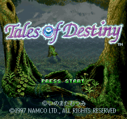
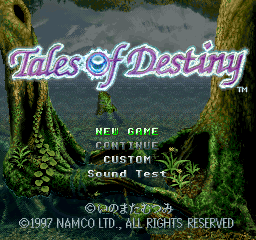
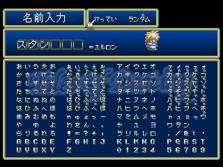

# Tales of Destiny Recompiled

A **static recompilation of *Tales of Destiny*** (PlayStation, Japan, `SLPS-01100`, 1997)
built on [psxrecomp](https://github.com/RetroPortingToolKit/psxrecomp). The game's MIPS
R3000A code is translated to C ahead of time and compiled into a native executable —
**no emulator, no interpreter for the game's own code**.

Nothing from the game is distributed here. You need your own disc.

## Status — `in-progress`

| Milestone | State |
|---|---|
| Recompiles and boots (LLE OpenBIOS) | **yes** |
| Title screen | **yes** |
| Main menu (*NEW GAME / CONTINUE / CUSTOM / Sound Test*) | **yes** |
| *NEW GAME* → name entry screen | **yes** |
| Past name entry: into the game, battles, save/load | not yet |
| The two minigame overlays | not yet (skipped) |
| Audio (XA voice, 94 SEQ tracks over VAB) | unverified |
| Full-motion video (six streams, three MDEC bitstream versions) | unverified |

  

Verified headless with the runtime's debug server (`get_registers`, `screenshot_file`,
`latency`) on a software renderer: guest `sp=0x801FFF10`, frame period 16.6 ms
(p95 17.6 ms) ≈ 58 fps.

## Numbers

| | |
|---|---|
| Boot EXE | 1,155,072 bytes, `0x800A0000`, entry `0x80151010` |
| Recompiled | 1,567 JAL seeds → **4,360 functions**, 293 shards, 15.5 M lines of C — 30 s |
| Built | 867 targets, 57.8 MB executable — 3.5 min at `-j8` |
| Disc it was measured against | track 1 `sha1 eb1c41fc…`, 518,719,488 bytes |

`generated/` is **not committed**: it is a 426 MB build artifact that takes 30 s to
regenerate. This is a source-development project for now.

## Build

```sh
git clone --recurse-submodules https://github.com/serranoid/TalesOfDestinyRecomp.git
cd TalesOfDestinyRecomp

# 1. Your own disc image (bin/cue). This extracts the boot EXE into disc/.
tools/prepare.sh "/path/to/Tales of Destiny (Japan).cue"

# 2. Recompiler + BIOS backends (once)
sh psxrecomp/tools/setup_dev.sh

# 3. Generated C (30 s)
tools/regen.sh

# 4. Native binary
cmake -S . -B build -G Ninja -DCMAKE_BUILD_TYPE=Release \
      -DPSX_RECOMP_UI=OFF -DPSX_NETPLAY=OFF -DPSX_REWIND=OFF
cmake --build build --target psx-runtime -j8

# 5. Run (headless + debug server)
PSX_DEBUG_SERVER=1 ./build/psx_runtime --game game.toml \
    --disc "disc/Tales of Destiny (Japan).cue" --headless --debug-port 4370
```

Set `PSX_RECOMP_UI=OFF` until a launcher UI is wired; the runtime needs SDL3 3.4+.

## How it is verified

No window, no GPU. The runtime exposes a JSON-over-TCP debug server on `127.0.0.1:4370`:

```json
{"id":1,"cmd":"get_registers"}
{"id":2,"cmd":"screenshot_file","path":"evidence/shot.png"}
{"id":3,"cmd":"latency"}
{"id":4,"cmd":"press","buttons":"0xFFF7","frames":90}
```

`buttons` is the raw active-low pad word: `Start` = `0xFFF7`, `○` (confirm) = `0xDFFF`,
`×` (cancel) = `0xBFFF`. The server closes the connection after each reply.

A milestone is done when a screenshot and the guest registers say so — not when it
compiles.

## Help wanted

See `help` in [`.recomp.json`](.recomp.json). Short version: audio, FMV, and the two
overlays.

## Legal

This repository contains no game data: no disc image, no extracted asset, no BIOS. It
ships the recompiler configuration, the build glue and the tooling. Running the result
requires the original disc, which the runtime checks. `Tales of Destiny` is © Namco.

The glue and scripts here are MIT (see `LICENSE`).
