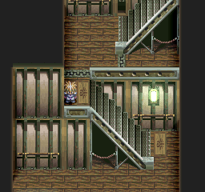

# Tales of Destiny Recompiled

A **static recompilation of *Tales of Destiny*** (PlayStation, North America, `SLUS-00626`, 1998)
built on [psxrecomp](https://github.com/RetroPortingToolKit/psxrecomp). The game's MIPS
R3000A code is translated to C ahead of time and compiled into a native executable.
The framework keeps an interpreter for code that changes at run time; measured from
boot through the whole opening scene to the first controllable room (about 30,000
frames), it ran **9 instructions of game code** (three small blocks the game patches
in memory). Everything else ran recompiled, with no dispatch miss.

Nothing from the game is distributed here. You need your own disc.

## Status — `in-progress`

| Milestone | State |
|---|---|
| Recompiles and boots (LLE OpenBIOS) | **yes** |
| Main menu (*NEW GAME / CONTINUE / CUSTOM / Sound Test*) | **yes** |
| *NEW GAME* → name entry screen | **yes** |
| Opening scene through to the first room where the player has control | **yes** |
| Battles, save/load | not yet |
| The two minigame overlays | not yet (skipped) |
| Audio (XA voice, 94 SEQ tracks over VAB) | produced through the opening, not yet listened to |
| Full-motion video (six streams, three MDEC bitstream versions) | the opening movie decodes; the rest unverified |

  

Verified headless with the runtime's debug server (`get_registers`, `screenshot_file`,
`dirty_ram_stats`) and in a window on OpenGL, where `latency` reports a frame period
of 16.68 ms (p95 16.69 ms), 60 fps, with no audio underrun.

## Numbers

| | |
|---|---|
| Boot EXE | 1,134,592 bytes, `0x800A0000`, entry `0x8014E8B4` |
| Recompiled | 1,541 JAL seeds → **4,579 dispatch entries**, 242 shards, 11.2 M lines of C — 2.4 s |
| Built | 765 targets, 45.5 MB executable — 58 s at `-j8` (12-thread desktop) |
| Disc it was measured against | track 1 `sha1 d0d6d150…`, 557,790,912 bytes |

`generated/` is **not committed**: it is a 304 MB build artifact that takes seconds to
regenerate. This is a source-development project for now.

## Build

```sh
git clone --recurse-submodules https://github.com/serranoid/TalesOfDestinyRecomp.git
cd TalesOfDestinyRecomp

# 1. Your own disc image (bin/cue). This extracts the boot EXE into disc/.
tools/prepare.sh "/path/to/Tales of Destiny (USA).cue"

# 2. Recompiler + BIOS backends (once)
sh psxrecomp/tools/setup_dev.sh

# 3. Generated C
tools/regen.sh

# 4. Native binary
cmake -S . -B build -G Ninja -DCMAKE_BUILD_TYPE=Release \
      -DPSX_RECOMP_UI=OFF -DPSX_NETPLAY=OFF -DPSX_REWIND=OFF
cmake --build build --target psx-runtime -j8

# 5. Run (headless + debug server)
PSX_DEBUG_SERVER=1 ./build/psx_runtime --game game.toml \
    --disc "/path/to/Tales of Destiny (USA).cue" --headless --debug-port 4370
```

Set `PSX_RECOMP_UI=OFF` until a launcher UI is wired; the runtime needs SDL3 3.4+.

Drop `--headless` to play in a window. Without the launcher, player 1 is the keyboard
(`Enter` = Start, `S` = ○, `X` = ×, `A` = △, `Z` = □). To play with a gamepad, add
this to `game.toml` (checked with an Xbox Wireless Controller; confirm is **B**):

```toml
[controller]
p1_device = "auto"
```

## How it is verified

No window, no GPU. The runtime exposes a JSON-over-TCP debug server on `127.0.0.1:4370`:

```json
{"id":1,"cmd":"get_registers"}
{"id":2,"cmd":"screenshot_file","path":"evidence/shot.png"}
{"id":3,"cmd":"latency"}
{"id":4,"cmd":"press","buttons":"0xFFF7","frames":90}
```

`buttons` is the raw active-low pad word: `Start` = `0xFFF7`, `○` (confirm) = `0xDFFF`,
`×` (cancel) = `0xBFFF`. The server closes the connection after each reply.

A milestone is done when a screenshot and the guest registers say so — not when it
compiles.

## Why the North American release

This project started on the Japanese release (`SLPS-01100`); that work is in the git
history. It moved to the North American one because the goal is a Spanish translation:
its text engine already handles the Latin alphabet. The two are the same engine: same
load address, and both builds interpret 9 instructions in three runtime-patched blocks.

## Goals

Run as well as possible on Linux, ultrawide, mods, and a Spanish translation — after
the original game is playable. See [ROADMAP.md](ROADMAP.md).

## Help wanted

See `help` in [`.recomp.json`](.recomp.json). Short version: the first
battle, save and load, audio, FMV, and the two overlays. [CONTRIBUTING.md](CONTRIBUTING.md)
explains how changes are verified and what must never be uploaded.

## Legal

This repository contains no game data: no disc image, no extracted asset, no BIOS. It
ships the recompiler configuration, the build glue and the tooling. Running the result
requires the original disc, which the runtime checks. `Tales of Destiny` is © Namco.

The glue and scripts here are MIT (see `LICENSE`).
